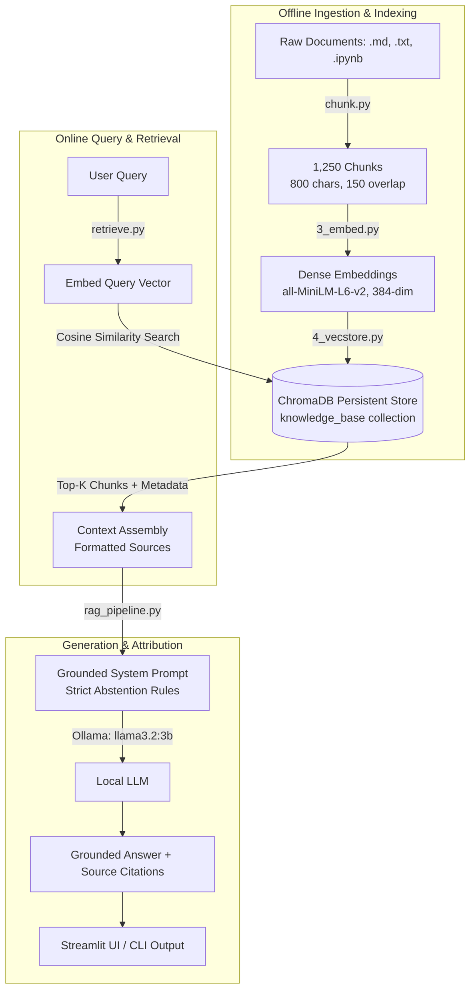

# Local RAG Knowledge Assistant

[](https://www.python.org/)
[](https://www.trychroma.com/)
[](https://huggingface.co/sentence-transformers/all-MiniLM-L6-v2)
[](https://ollama.ai/)
[](https://streamlit.io/)

A fully local, modular Retrieval-Augmented Generation (RAG) system engineered from the ground up with local embeddings, persistent vector storage, grounded prompt templates with explicit abstention rules, citation attribution, and automated retrieval benchmarking.

---

## 📌 Problem Statement

Foundation LLMs frequently hallucinate or confidently fabricate answers when queried on internal documentation, private codebases, or specialized knowledge beyond their training cutoff. 

This project constructs a complete, reproducible, and verifiable local RAG pipeline that:
1. **Grounds LLM responses** exclusively in retrieved knowledge chunks.
2. **Eliminates hallucinations** via strict system-prompt boundary constraints and mandatory abstention triggers ("I don't have enough information in the knowledge base to answer that").
3. **Provides verifiable attribution** by citing source documents and chunk numbers on every response.
4. **Protects privacy and costs** by executing 100% locally with zero external API calls.

---

## 🏗️ Architecture & Pipeline Flow



---

## 🧩 Pipeline Components

| Stage | Script | Technology | Description |
|---|---|---|---|
| **1. Chunking** | [chunk.py](chunk.py) | Python, JSON | Parses Markdown, plain text, and Jupyter Notebook cells (`markdown` and `code`), slicing documents into overlapping 800-character windows with 150-character overlap to preserve semantic continuity across boundaries. Produces 1,250 indexed chunks. |
| **2. Embeddings** | [3_embed.py](3_embed.py) | `sentence-transformers` | Generates normalized 384-dimensional dense vectors using `all-MiniLM-L6-v2` and persists them as a NumPy array (`embeddings.npy`). |
| **3. Vector Store** | [4_vecstore.py](4_vecstore.py) | `chromadb` | Populates a persistent ChromaDB database (`vector_store/`) indexing chunk text, IDs, and rich metadata (file path, chunk index). |
| **4. Retrieval Engine** | [retrieve.py](retrieve.py) | `chromadb`, PyTorch | Encodes incoming queries, executes nearest-neighbor cosine queries against ChromaDB, and returns ranked chunks with similarity distance scores. |
| **5. Grounded RAG** | [rag_pipeline.py](rag_pipeline.py) | `ollama` (`llama3.2:3b`) | Constructs an isolated context block, injects anti-hallucination prompt boundaries, prompts the local LLM at `temperature=0`, and returns attributed answers. |
| **6. Web Interface** | [app.py](app.py) | `streamlit` | Clean, interactive web UI with real-time Top-K tuning (1–5), response latency tracking, and collapsible source evidence inspectors. |

---

## 🛡️ Anti-Hallucination & Grounding Strategy

The system prompt enforces five non-negotiable operational invariants:
1. **Closed-Domain Constraint:** The model is forbidden from using pre-training knowledge to answer domain questions.
2. **Explicit Abstention Protocol:** If the retrieved chunks lack sufficient evidence, the model must return verbatim:
   > *"I don't have enough information in the knowledge base to answer that."*
3. **Zero Fabrication:** Speculation or extrapolating missing steps is prohibited.
4. **Attribution Requirement:** Every answered query must terminate with an explicit list of source numbers used (e.g. `Sources used: [1, 2]`).
5. **Deterministic Inference:** Configured with `temperature: 0` to prevent stochastic hallucinations across runs.

---

## 🔬 Evaluation & Benchmarks

The repository includes dual evaluation suites assessing answer accuracy, abstention reliability, and Top-K retrieval dynamics:

### 1. Behavioral & Abstention Benchmark (`7_rag_eval.py`)
Tests 10 curated questions across varying Top-K configurations:
- **6 Answerable In-Scope Queries** (e.g., tokenization mechanisms, vector database roles, chunking strategies).
- **4 Out-of-Scope / Adversarial Queries** (questions intentionally absent from the corpus to verify abstention compliance).

### 2. Retrieval Attribution & Top-K Parameter Study (`rag_test_cases.py`)
Evaluates retrieval sensitivity across $K \in \{1, 3, 5\}$:
- **Abstention Accuracy:** Percentage of out-of-scope prompts that triggered strict refusal.
- **Source Match Rate:** Precision of retrieving chunks originating from the ground-truth topic document.
- **Irrelevant Chunk Ratio:** Measures context contamination as $K$ increases.
- **Latency Profiling:** End-to-end response time tracking across vector search and model inference.

---

## 🚀 Quickstart & Setup

### 1. Prerequisites
- Python 3.10+
- [Ollama](https://ollama.ai/) installed and running locally
- Pull the 3B inference model:
  ```bash
  ollama pull llama3.2:3b
  ```

### 2. Installation
```bash
git clone https://github.com/your-username/rag-knowledge-assistant.git
cd rag-knowledge-assistant
pip install -r requirements.txt
```

### 3. Pipeline Indexing (Pre-built artifacts included)
*Note: The repository already includes indexed `chunks.json`, `embeddings.npy`, and `vector_store/`. To re-index from scratch:*
```bash
# Extract and chunk documents
python chunk.py

# Compute vector embeddings
python 3_embed.py

# Build ChromaDB collection
python 4_vecstore.py
```

### 4. Running the Assistant
#### Web Interface (Streamlit)
```bash
streamlit run app.py
```

#### Terminal CLI Mode
```bash
python rag_pipeline.py
```

#### Run Automated Evaluation
```bash
python 7_rag_eval.py
python rag_test_cases.py
```

---

## 📁 Repository Structure

```
rag-knowledge-assistant/
├── chunk.py                  # Document ingestion and character-overlap chunker
├── 3_embed.py                # Batch vector embedding with all-MiniLM-L6-v2
├── 4_vecstore.py             # ChromaDB persistent collection loader
├── retrieve.py               # Semantic query encoder and cosine search engine
├── rag_pipeline.py           # Grounded prompt assembly and Ollama inference
├── app.py                    # Streamlit web application with source inspectors
├── 7_rag_eval.py             # Behavioral evaluation suite (answer vs. abstain)
├── rag_test_cases.py         # Advanced evaluation (source match & Top-K tuning)
├── requirements.txt          # Python dependencies
├── chunks.json               # Serialized chunk corpus (1,250 chunks)
├── embeddings.npy            # Precomputed embedding matrix (1250 x 384)
├── vector_store/             # Persistent ChromaDB SQLite & segment files
└── Data/                     # Raw knowledge documents (.md, .txt, .ipynb)
    └── Content/              # Educational modules (tokens, embeddings, RAG, LLMs)
```

---

## 📄 License

This project is licensed under the MIT License.
